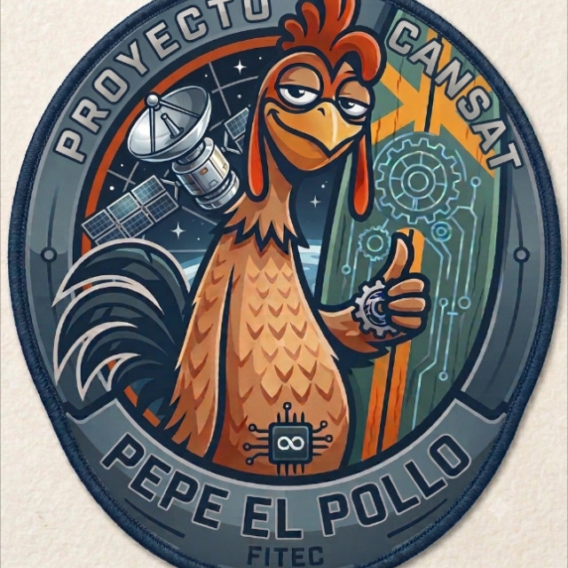
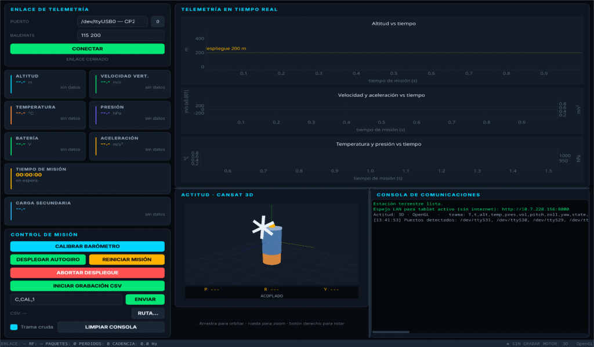
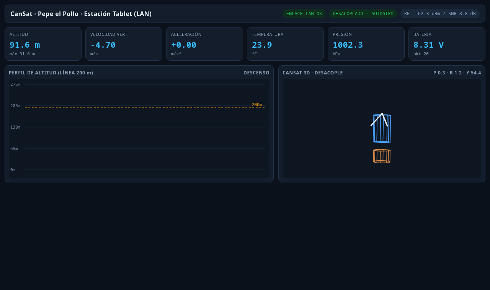

# CanSat "Pepe el Pollo" · Ordenador de a Bordo y Estación Terrestre

Sistema completo de vuelo y telemetría para el proyecto integrador **CanSat (PEUUM 2026 — FITEC)**: firmware C++ compatible con `arduino-cli` para dos placas **Heltec WiFi LoRa 32 V3 (ESP32-S3 + SX1262 915 MHz + OLED 0.96")**, estación terrestre de escritorio en **Python (PyQt5 + PyQtGraph + OpenGL)** con modelo 3D animado de desacoplamiento, grabación dual **CSV + JSONL**, análisis post-vuelo y **espejo web LAN 100 % offline** para tablets.

<p align="center">
  
</p>

---

## 1. Arquitectura del sistema

```text
  ┌──────────────────────────┐    LoRa 915.0 MHz     ┌──────────────────────────┐
  │  CANSAT TX (En vuelo)    │   SF7 / BW125 / CRC   │  GROUND RX (En tierra)   │
  │  Heltec WiFi LoRa 32 V3  │ ────────────────────▶ │  Heltec WiFi LoRa 32 V3  │
  │  BMP280 + BNO08x (Wire1) │ ◀──────────────────── │  OLED con insignia +     │
  │  SG90 (autogiro 200 m)   │   comandos uplink     │  anexo de RSSI / SNR     │
  └──────────────────────────┘                       └────────────┬─────────────┘
                                                                  │ USB Serial 115200
                                                                  │ CSV + RSSI/SNR
                                                     ┌────────────▼─────────────┐
                                                     │  ESTACIÓN TERRESTRE (PC) │
                                                     │  Python / PyQt5 / OpenGL │
                                                     │  CSV + JSONL + Análisis  │
                                                     └────────────┬─────────────┘
                                                                  │ Wi-Fi / Hotspot LAN
                                                                  │ (sin internet, :8000)
                                                     ┌────────────▼─────────────┐
                                                     │  ESPEJO WEB EN TABLET    │
                                                     │  HTML5 / SSE / Canvas 3D │
                                                     └──────────────────────────┘
```

---

## 2. Explicación del código y funciones principales

### A. Firmware C++ (`arduino-cli`, target `esp32:esp32:heltec_wifi_lora_32_V3`)

1. **[`firmware/cansat_tx/cansat_tx.ino`](firmware/cansat_tx/cansat_tx.ino)** — Ordenador de a bordo (TX)
   - **Bus I2C secundario (`Wire1`):** Mapeado a `PIN_I2C_SDA = 41` y `PIN_I2C_SCL = 42` a `100 kHz` para no interferir con la OLED (`17/18`), el radio SX1262 (`8..14`) ni el puerto serie USB (`GPIO 43`).
   - **`pollSensors()`**: Lee el barómetro **BMP280** (`0x76`/`0x77`) y el IMU **BNO08x** (`0x4A`/`0x4B`), aplica un **filtro alpha-beta** para estimar altitud y velocidad vertical, rota la aceleración lineal al marco vertical del mundo y sanea cualquier `NaN` o valor fuera de rango (`sanitizeFloat()`). Si el IMU no está conectado, la misión continúa con el barómetro sin bloquearse.
   - **`updateMissionState()`**: Máquina de estados (`PRE → ASCENSO → DESCENSO → ATERRIZAJE → FIN`) con disparo predictivo del servomotor **SG90** (`GPIO 5`) cerca de **200 m** considerando el retardo mecánico del servo (`SERVO_DELAY_S`).
   - **`transmitTelemetry()`**: Envía la trama CSV de telemetría por LoRa SX1262 a `915.0 MHz` y abre una ventana breve para recibir comandos desde tierra (`C,CAL,1`, `C,DEP,DEPLOY`, `C,CHUTE,CUT`, `C,SYS,RESET`).
   - **`refreshOled()`**: Muestra en la OLED 0.96" el estado de sensores (`BMP:OK / IMU:OK / RF:OK`), altitud, velocidad, temperatura, presión, batería y contador de paquetes.

2. **[`firmware/ground_rx/ground_rx.ino`](firmware/ground_rx/ground_rx.ino)** y **[`firmware/ground_rx/logo.h`](firmware/ground_rx/logo.h)** — Receptor LoRa→USB (RX)
   - **`drawTeamSplash()`**: Muestra la insignia del equipo **"Pepe el Pollo"** (`64×64` XBM en `PROGMEM`) al arrancar y mientras espera el enlace LoRa (`WAIT 915`).
   - **`processIncomingLora()`**: Recibe cada trama CSV por interrupción (`DIO1`), consulta `radio.getRSSI()` y `radio.getSNR()`, los anexa al final de la línea y la envía limpia por USB Serial a `115200` baudios.
   - **`processSerialCommands()`**: Escucha comandos enviados desde la interfaz de Python y los transmite por LoRa hacia el CanSat.

*(El repositorio conserva además los proyectos originales de PlatformIO en `firmware/cansat`, `firmware/estacion` y `firmware/baliza`.)*

### B. Estación Terrestre en Python (`main.py`, `gs/`, `tools/`)

- **[`main.py`](main.py)**: Punto de entrada con soporte de flags `--sim`, `--port`, `--baud` y `--web-port` (puerto del espejo LAN para tablet, `8000` por defecto).
- **[`gs/protocol.py`](gs/protocol.py)**: Define la estructura `Telemetry`, el parser tolerante `parse_telemetry()` (admite tramas de 13, 16 o 18 campos con `rssi` y `snr`, saneando `NaN`/infinitos), `format_csv_row()` y `telemetry_to_dict()`.
- **[`gs/serial_worker.py`](gs/serial_worker.py)**: Hilo `QThread` dedicado para lectura serie no bloqueante, cálculo de paquetes perdidos/cadencia y ejecución del simulador de vuelo.
- **[`gs/flight_profile.py`](gs/flight_profile.py)**: Modelo físico determinista del vuelo sintético (ascenso a 450 m, caída libre, autogiro a 200 m, aterrizaje y simulación de RSSI/SNR).
- **[`gs/recording.py`](gs/recording.py)**: Grabador thread-safe (`CsvRecorder`) que escribe simultáneamente el registro en **CSV** y su espejo estructurado en **JSONL**.
- **[`gs/widgets/attitude.py`](gs/widgets/attitude.py)**: Visor **OpenGL 3D** (`Satellite3DView`) del CanSat de 2 etapas (primaria azul + secundaria ámbar + 3 palas de autogiro) con animación de desacoplamiento y giro del rotor cuando `chute == 1`, `satellite == 1` o al cruzar `200 m` en descenso. Incluye horizonte artificial 2D como respaldo.
- **[`gs/web_mirror.py`](gs/web_mirror.py)**: Servidor HTTP + Server-Sent Events (`WebMirrorServer`) con librería estándar de Python y dashboard HTML5/Canvas autocontenido (**sin internet ni CDNs**), permitiendo ver telemetría, gráfica de altitud y CanSat 3D desde cualquier tablet en la misma red Wi-Fi o hotspot local.
- **[`gs/main_window.py`](gs/main_window.py)**: Dashboard principal PyQt5 (conexión, tarjetas de indicadores, gráficas en vivo, actitud 3D, consola de eventos, barra de estado con `RSSI/SNR` y controles de misión).
- **[`tools/analisis_vuelo.py`](tools/analisis_vuelo.py)**: Script post-vuelo que genera `<vuelo>_procesado.csv`, `<vuelo>_resumen.json` y gráficas de altura, velocidad y actitud.

---

## 3. Cableado del CanSat TX (Heltec WiFi LoRa 32 V3)

El chip LoRa SX1262 (`SCK=9, MISO=11, MOSI=10, CS=8, DIO1=14, RST=12, BUSY=13`) y la OLED (`SDA=17, SCL=18, RST=21, Vext=36`) vienen integrados en la placa. Solo se cablean los periféricos externos:

| Periférico | Señal | GPIO Heltec V3 | Notas |
| --- | --- | ---: | --- |
| BMP280 + BNO08x | I²C SDA | **41** | Alimentación a **3.3 V** |
| BMP280 + BNO08x | I²C SCL | **42** | Bus secundario `Wire1` a 100 kHz |
| Servo SG90 | PWM | **5** | Alimentar a 5 V desde Mini360 (GND común) |
| Batería | ADC | **1** | Divisor resistivo (`BATTERY_DIVIDER = 2.0`) |

---

## 4. Instalación, flasheo y ejecución

### Compilar y subir firmwares (`arduino-cli`)

**Placa 1 — CanSat TX (en el satélite):**
```bash
arduino-cli compile --fqbn esp32:esp32:heltec_wifi_lora_32_V3 firmware/cansat_tx
arduino-cli upload  --fqbn esp32:esp32:heltec_wifi_lora_32_V3 -p /dev/ttyUSB0 firmware/cansat_tx
```

**Placa 2 — Ground RX (conectada por USB a la PC):**
```bash
arduino-cli compile --fqbn esp32:esp32:heltec_wifi_lora_32_V3 firmware/ground_rx
arduino-cli upload  --fqbn esp32:esp32:heltec_wifi_lora_32_V3 -p /dev/ttyUSB0 firmware/ground_rx
```

### Ejecutar la Estación Terrestre en Python

```bash
python3 -m venv .venv
source .venv/bin/activate        # en Fish shell: source .venv/bin/activate.fish
pip install -r requirements.txt

# Modo simulación (sin hardware)
python3 main.py --sim

# Modo real (receptor Heltec RX conectado por USB)
python3 main.py --port /dev/ttyUSB0 --baud 115200
```

Al iniciar, la consola muestra la URL local del espejo para tablet (por ejemplo `http://192.168.x.x:8000`). Funciona sobre cualquier red Wi-Fi o hotspot local **sin internet**.

---

## 5. Evidencias de funcionamiento

### 5.1 Estación terrestre de escritorio (PyQt5 + OpenGL 3D + Espejo LAN activo)


### 5.2 Espejo Web LAN en tablet (100 % offline) con desacoplamiento y autogiro 3D

